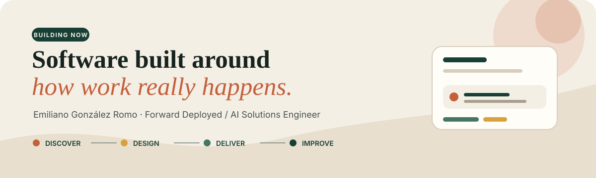

  

 

<table>
<tr>
<td width="64%" valign="top">

### I turn operational complexity into useful software.

I work between **customers, product, and engineering**: understanding how a team actually operates, translating that reality into a system, and carrying it from an unclear problem to a deployed product.

My strongest work combines:

- direct customer and workflow discovery;
- full-stack product delivery;
- applied AI with explicit human and data boundaries;
- technical decisions connected to business outcomes.

</td>
<td width="36%" valign="top">

### Current focus

**Forward Deployed Engineering**  
**AI Solutions Engineering**  
**Full-Stack Product Delivery**

Monterrey, Mexico · Open to remote and international teams

</td>
</tr>
</table>

  
  
  

---

## Selected work

<table>
<tr>
<td width="58%" valign="top">

### PropPilot · StateAI

**Independent product · Lead engineering**

A vertical SaaS for real-estate acquisition and property-flipping operations. PropPilot connects lead capture, property files, debt context, proposals, negotiation, follow-up, and post-acquisition operations in one workflow.

I own the path from operational discovery to product definition, architecture, full-stack implementation, AI boundaries, security, testing, and delivery.

**Built around**

`Next.js` · `React` · `TypeScript` · `FastAPI` · `PostgreSQL` · `Supabase` · `Python`

[Open the live product →](https://state-ai-frontend.vercel.app/)  
[Read the engineering case study →](https://github.com/h8hyf2rw9y-afk/StateAI-Overview)

</td>
<td width="42%" valign="top">

### What makes it different

PropPilot was not designed from a generic CRM template. It came from observing real acquisition work: fragmented messages, incomplete files, debt calculations, handoffs, proposals, and follow-up that usually live across spreadsheets and memory.

The product turns that ambiguity into a visible operating process while keeping sensitive decisions under human control.

</td>
</tr>
</table>

<table>
<tr>
<td width="50%" valign="top">

### Engineering Portfolio

A recruiter-focused portfolio covering selected projects, experience, and technical decisions.

- Responsive desktop and mobile design
- English and Spanish presentation
- Expandable project narratives
- Privacy-conscious contact handling
- Automated GitHub Pages deployment

[View the portfolio →](https://h8hyf2rw9y-afk.github.io/Portfolio/)

</td>
<td width="50%" valign="top">

### Public engineering case study

The production repositories for PropPilot remain private. The public case study explains the verified scope without exposing credentials, prompts, schemas, client records, or proprietary source code.

It covers architecture, workflow modeling, AI safety boundaries, delivery practices, and my ownership.

[Explore StateAI-Overview →](https://github.com/h8hyf2rw9y-afk/StateAI-Overview)

</td>
</tr>
</table>

---

## Selected earlier work

These repositories currently live on my secondary GitHub account and will be consolidated gradually. Each project is labeled by context and ownership.

<table>
<tr>
<td width="34%" valign="top">

### BabyDuck Compiler

**Academic project · Individual implementation**

A multi-stage compiler built with Java, Maven, and ANTLR4: lexical, syntactic, and semantic analysis; intermediate quadruple generation; virtual memory; and execution through a custom virtual machine.

**What I learned:** language design, parsing, type validation, intermediate representation, memory models, and technical documentation.

[Review the compiler →](https://github.com/MasterZendika/BabyDuck-Compiler)

</td>
<td width="33%" valign="top">

### Autonomous Harvest Simulation

**Academic AI project**

A 2D agricultural simulation exploring autonomous tractor agents for corn harvesting with Unity ML-Agents, C#, and Python.

**What I learned:** agent/environment modeling, reward-driven behavior, simulation design, experimentation, and connecting Unity with an ML workflow.

[Explore the simulation →](https://github.com/MasterZendika/REVISION)

</td>
<td width="33%" valign="top">

### Raíces

**Personal web project**

A visual graduation experience built with HTML, JavaScript, Tailwind CSS, and static deployment on Vercel.

**What I learned:** visual storytelling, responsive composition, asset-heavy web delivery, interaction design, and deploying a focused static experience.

[Open the live experience →](https://raices-six.vercel.app/)  
[Review the source →](https://github.com/MasterZendika/raices)

</td>
</tr>
</table>

<table>
<tr>
<td width="34%" valign="top">

### HackMTY · Capital One Challenge

**Hackathon project · Team collaboration**

A financial-literacy and customer-engagement prototype built during HackMTY 2023 for the Capital One challenge. The team worked under a 48-hour deadline to turn an open brief into a functional web experience.

**My contribution:** frontend development, interaction design, and integration work around financial data.

**What it demonstrates:** rapid prototyping, collaborative delivery, API-driven product development, and decision-making under time pressure.

[Review the team repository →](https://github.com/EstebanAleman21/404_NOTFOUND)  
[Learn about HackMTY →](https://hackmty.com/)

</td>
<td width="33%" valign="top">

### Dilo en Señas

**Accessibility project · Team collaboration**

A cross-platform mobile experience designed to help bridge communication with the deaf community through text-to-sign-language translation.

**My contribution:** accessible UI development, API integration, and attention to a clear, security-conscious user experience.

**What it demonstrates:** inclusive product thinking, React Native development, real-time interaction design, and building technology around a concrete human need.

[Review the team repository →](https://github.com/AlonsoM207/Reto_Equipo1)

</td>
<td width="33%" valign="top">

### FRIDA PDF Analyst

**Document intelligence project · Team collaboration**

A React-based interface for uploading and analyzing documents, presenting results such as summaries, indexes, figures, word frequency, and related terms in a navigable workflow.

**What it solves:** reduces the friction of reviewing long documents by organizing analysis into focused, accessible views.

**What it demonstrates:** multi-step frontend workflows, file-upload UX, API-connected interfaces, authentication flows, and presenting structured analysis clearly.

[Review the team repository →](https://github.com/Spooderman0/pdf-reader)

</td>
</tr>
</table>

---

## How I work

| 01 — Discover | 02 — Design | 03 — Deliver | 04 — Improve |
|---|---|---|---|
| Observe the real workflow and define the outcome. | Turn ambiguity into requirements, models, interfaces, and boundaries. | Build a useful vertical slice across product and engineering. | Validate with users, measure friction, and prioritize the next iteration. |

> I am most useful where the problem is still partially undefined and the solution has to work for real people—not only pass a technical demo.

---

## Building consistently

<picture>
  <source media="(prefers-color-scheme: dark)" srcset="https://raw.githubusercontent.com/h8hyf2rw9y-afk/h8hyf2rw9y-afk/output/contributions-dark.svg" />
  <source media="(prefers-color-scheme: light)" srcset="https://raw.githubusercontent.com/h8hyf2rw9y-afk/h8hyf2rw9y-afk/output/contributions-light.svg" />
  
</picture>

The animation updates automatically every day. Activity from private repositories appears only when GitHub can attribute it to this account and private contributions are enabled.

---

<strong>Technical toolkit</strong>

 

| Area | Tools and practices |
|---|---|
| Product engineering | TypeScript, JavaScript, React, Next.js, Vite, Tailwind CSS |
| Backend and data | Python, FastAPI, Pydantic, PostgreSQL, Supabase, SQLAlchemy, Alembic |
| Cloud and delivery | Docker, GitHub Actions, AWS, Google Cloud, Vercel |
| Applied AI | Structured extraction, contextual retrieval, workflow assistants, human-in-the-loop actions |
| Engineering practice | Git, automated testing, CI/CD, technical documentation, iterative delivery |

<strong>Experience perspective</strong>

 

- **Crestify** — Founding Engineer / Co-Founder
- **Wizeline** — Full-Stack Developer Intern
- **Nodoo** — Sales Engineer
- **Softtek** — Technology & Business Project Analyst
- **Arca Continental** — Junior Special Project Manager Intern

This mix of product, engineering, operations, and customer-facing work shapes how I build: technical decisions must remain understandable to stakeholders and useful to the people operating the system.

<strong>Current learning</strong>

 

- Linux foundations
- Model Context Protocol — fundamentals and advanced topics
- Claude Code workflows
- Agent Skills
- AI Fluency for Builders

*Coursework is in progress unless explicitly marked as completed.*

---

### Useful software begins with understanding the work.

[PropPilot](https://state-ai-frontend.vercel.app/) · [Portfolio](https://h8hyf2rw9y-afk.github.io/Portfolio/) · [LinkedIn](https://www.linkedin.com/in/emiliano-gonzalez-tech/) · [Engineering Case Study](https://github.com/h8hyf2rw9y-afk/StateAI-Overview)

